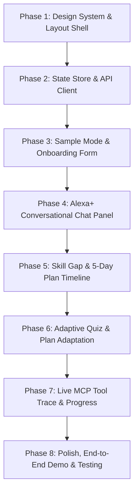

# 🚀 Member 1 Implementation Plan: Frontend & Alexa+ Simulator

> **Role:** Frontend / Simulator Lead (Member 1)  
> **Workspace:** `apps/simulator/`  
> **Target Track:** Amazon Developer Hackathon 2026 — Alexa+ Track  
> **Tech Stack:** React 19, TypeScript 5.7+, Vite 6, Vanilla CSS Design System (Glassmorphism & Dark Mode)  
> **Key References:** [ChartKeep MCP](https://github.com/sherotree/chartkeep-mcp), [Alexa+ Smart Home](https://github.com/guptachetan1995/alexa-plus), Amazon Developer Hackathon Team Guide

---

## 🎯 Executive Overview & Goals

As **Member 1 (Frontend & Simulator Lead)**, you are responsible for delivering the entire user-facing experience of CareerPilot AI. Because official Alexa+ hardware/private previews are restricted, Amazon encourages a **high-fidelity web simulator** that faithfully recreates the Alexa+ conversational agent workflow.

### Key Objectives:
1. **Alexa+ Conversational Agent UI**: Modern voice/chat simulator with speech bubbles, suggested quick prompts, and inline tool execution cards.
2. **One-Click Sample Mode**: Allow judges and teammates to load realistic sample resumes and job postings with a single click (no manual typing or personal data required).
3. **Skill Gap Visualizer**: Interactive cards categorizing skills into *Evidenced Matches*, *Partial Matches*, and *Critical Missing Gaps* with resume evidence quotes.
4. **Interactive 5-Day Study Plan Timeline**: Dynamic schedule with time budgets, learning goals, daily tasks, and interactive completion checkboxes.
5. **Adaptive Quiz Interface**: 3–5 question multiple-choice quiz engine with instant deterministic grading, score celebration, and automatic plan re-prioritization on weak scores.
6. **Live MCP Tool Trace Inspector**: Transparent drawer/feed displaying real-time MCP tool invocations (`analyze_job`, `compare_skills`, `generate_plan`, `generate_quiz`, `record_quiz_result`) with status, execution time, and raw payloads. **Strict Truthfulness Requirement:** Never fake success; truthfully display errors when they occur.
7. **Progress & Analytics Dashboard**: Visual progress bars, topic mastery ratings, and session persistence across page refreshes.

---

## 📦 What We Will Need (Prerequisites & Assets)

### 1. Dependencies (in `apps/simulator/package.json`)
- `react`, `react-dom` (v19+)
- `lucide-react` (or lightweight SVG icons for audio waves, checkmarks, brain, chevron, sparkles)
- `canvas-confetti` (optional, for quiz completion celebration)
- `typescript`, `vite`, `@vitejs/plugin-react`

### 2. Design Tokens & Styling
- Curated dark-mode palette (`#0a0e17` background, `#111827` secondary, `#1e293b` cards)
- Neon accent gradients (Amazon Alexa cyan `#00a8e8`, indigo `#6366f1`, emerald `#10b981`, amber `#f59e0b`)
- Glassmorphic panels with subtle borders (`rgba(255, 255, 255, 0.08)`) and backdrop blur
- Typography: System modern sans-serif stack (`Inter`, `-apple-system`, `Segoe UI`, `Roboto`)

### 3. API Contracts (`src/lib/api.ts`)
- `POST /api/analysis/job`
- `POST /api/analysis/resume`
- `POST /api/analysis/compare`
- `POST /api/plans/generate`
- `PATCH /api/plans/:sessionId/day/:dayNum`
- `POST /api/quiz/generate`
- `POST /api/quiz/submit`
- `GET /api/progress/:sessionId`
- `GET /api/tools/trace` (or SSE listener for real MCP events)

---

## 🏗️ Phase-Wise Implementation Roadmap

---

### Phase 1: Design System & Layout Shell (Est. 45 mins)
*Goal: Create a state-of-the-art, WOW-factor UI shell with responsive layout and glassmorphism styling.*

- [ ] **1.1 Global Design System (`src/styles/index.css`)**
  - Define CSS custom properties (colors, shadows, glow effects, borders, transitions).
  - Configure Alexa+ branded accents (Alexa cyan `#00c8ff`, dark slate `#0b1120`, violet `#8b5cf6`).
  - Add micro-animations: pulse on voice listening, shimmer skeletons, smooth tab transitions.
- [ ] **1.2 Simulator Layout Architecture (`src/App.tsx`)**
  - **Header Bar**: Project logo, active session ID badge, "Sample Mode" toggle/button, Backend/MCP connection health indicator.
  - **Two-Column Split Layout**:
    - *Left Column (45%)*: Conversational Alexa+ Chat Simulator with voice wave visualizer.
    - *Right Column (55%)*: Multi-tab Interactive Context Workspace (Analysis, Plan Timeline, Quiz, Progress, Tool Trace).
  - **Bottom / Side Drawer**: Collapsible Real-Time MCP Tool Call Inspector.

---

### Phase 2: State Store, Types & API Client (Est. 45 mins)
*Goal: Centralize state management and typed communication with the backend.*

- [ ] **2.1 TypeScript Schemas & Types (`src/types/index.ts`)**
  - `JobAnalysisResult`, `ResumeAnalysisResult`, `SkillComparison`
  - `PlanDay`, `StudyPlan`, `QuizQuestion`, `QuizSubmission`, `QuizResult`
  - `SessionProgress`, `ToolTraceItem`
- [ ] **2.2 Robust API Client (`src/lib/api.ts`)**
  - Implement resilient `fetch` wrappers with timeout handling and clear error messages.
  - Built-in fallback to mock sample responses when backend or LLM API is unavailable/rate-limited (guarantees offline demo works).
- [ ] **2.3 Session State (`src/context/SimulatorContext.tsx` or hook-based store)**
  - Manage active session ID, user messages, current plan, active quiz, skill gaps, and tool call logs.
  - Sync state to `localStorage` for automatic recovery on page refresh.

---

### Phase 3: Sample Mode & Onboarding Form (Est. 45 mins)
*Goal: Provide zero-friction input with instant sample prefill for judging.*

- [ ] **3.1 Onboarding Component (`src/components/JobInputForm.tsx`)**
  - Textarea for Job Description with character counter and syntax placeholder.
  - Textarea/paste input for Candidate Resume.
  - Configuration options: Available days (e.g. 3, 5, 7 days), Daily study time (30, 45, 60, 90 mins).
- [ ] **3.2 "Load Sample Data" One-Click Feature**
  - Pre-populate with our realistic *Senior Full-Stack Engineer* job description and *Alex Morgan* resume.
  - Visually highlight that demo mode is active so judges know no manual typing is required.
- [ ] **3.3 Submit & Analysis Trigger**
  - Loading skeleton state with animated step indicators ("Analyzing job...", "Matching resume...", "Identifying gaps...").

---

### Phase 4: Alexa+ Conversational Chat Panel (Est. 1 hour)
*Goal: Create the primary simulated Alexa+ experience with voice-like conversational pacing.*

- [ ] **4.1 Chat Feed (`src/components/ChatPanel.tsx`)**
  - Chat bubbles: User query (right, cyan-bordered) and Alexa+ response (left, glowing avatar).
  - Simulated Voice Audio Waveform animation during agent "speaking/thinking" states.
  - Quick action suggestion chips below input:
    - *"Analyze my resume for this job"*
    - *"Generate my 5-day study plan"*
    - *"Quiz me on System Design"*
    - *"How is my overall progress?"*
- [ ] **4.2 Inline Tool Invocation Badges**
  - Whenever an action triggers an MCP tool, display a compact badge inside the chat stream:
    `⚡ Executed tool: compare_skills (240ms) [View Trace]`
  - Clicking jumps directly to the Tool Trace tab for verification.

---

### Phase 5: Skill Gap Visualizer & 5-Day Plan Timeline (Est. 1 hour)
*Goal: Beautifully display the core analytical deliverables of the agent.*

- [ ] **5.1 Skill Gap Panel (`src/components/SkillGapPanel.tsx`)**
  - Overall Match Score gauge (e.g., 68% Match).
  - 3-Column Categorization:
    - 🟢 **Evidenced Matches** (skills matched directly from resume with highlighted excerpt).
    - 🟡 **Partial / Inferred Matches** (related technologies).
    - 🔴 **Critical Missing Gaps** (high-priority topics that must be scheduled).
  - Action button: *"Generate Personalized Study Plan"*
- [ ] **5.2 Plan Timeline Component (`src/components/PlanTimeline.tsx`)**
  - Interactive multi-day cards (Day 1 to Day 5).
  - Card Details: Day #, Topic, Learning Objectives, Daily minutes budget, Hands-on practice task.
  - Interactive status toggles: Checkbox to mark day complete, which updates progress in real time.
  - Topic action button: *"Take Quiz on This Topic"*.

---

### Phase 6: Adaptive Quiz Experience & Plan Adaptation (Est. 1 hour)
*Goal: Complete the core hackathon loop: quiz grading that adapts the learning plan.*

- [ ] **6.1 Interactive Quiz Component (`src/components/QuizPanel.tsx`)**
  - Topic header with difficulty tag and question progress (`Question 2 of 3`).
  - Radio button options for deterministic multiple-choice selection.
  - Smooth progression between questions.
- [ ] **6.2 Instant Deterministic Grading & Results View**
  - Shows score percentage, correct answer breakdown, and explanatory notes.
  - High score (≥70%): Celebration confetti + "Topic Mastered! Ready for next day."
  - Weak score (<70%): Constructive guidance + *"Plan Adapted: Topic added to Day 4 review."*
- [ ] **6.3 Live Plan Adaptation Visualizer**
  - Banner indicating: *"Study plan updated based on your quiz results"*.
  - Timeline immediately reflects the re-prioritized topic.

---

### Phase 7: Live MCP Tool Trace & Progress Dashboard (Est. 45 mins)
*Goal: Provide total architectural transparency for hackathon evaluators.*

- [ ] **7.1 Real-Time Tool Trace Drawer (`src/components/ToolTrace.tsx`)**
  - Live table/card log of every MCP call:
    - Timestamp & Duration (ms)
    - Tool Name (`analyze_job`, `compare_skills`, `generate_plan`, `generate_quiz`, `record_quiz_result`)
    - Input parameters (sanitized, formatted JSON)
    - Status pill (`SUCCESS 200`, `PENDING...`, `FAILED 500`)
    - Output payload preview (expandable JSON tree)
  - Copy JSON button for debugging.
  - Truthful error display: clearly shows network/provider timeouts if they happen.
- [ ] **7.2 Progress Dashboard (`src/components/ProgressPanel.tsx`)**
  - Radial or linear preparation completion meter.
  - Average quiz score across all topics.
  - Completed study days counter (e.g. `2 / 5 Days Completed`).
  - "Reset Session" button to start a fresh demo run.

---

### Phase 8: Polish, End-to-End Testing & Demo Readiness (Est. 30 mins)
*Goal: Ensure flawless judging demo flow and zero console errors.*

- [ ] **8.1 Judging Golden Path Verification**
  - 1. Open app → Click "Load Sample Data".
  - 2. Click "Analyze" → Review Skill Gap cards & Match Score.
  - 3. Click "Generate Plan" → Inspect 5-Day Timeline.
  - 4. Click "Take Quiz" → Answer questions → Submit and observe score.
  - 5. Observe Plan Adaptation if weak score, or completion mark.
  - 6. Open Tool Trace → Show judges all real MCP tool executions.
- [ ] **8.2 Cross-browser & Responsiveness Check**
  - Validate at standard desktop (1920x1080 and 1440x900) and laptop (1280x800).
- [ ] **8.3 Production Build Verification**
  - Run `npm run build` inside `apps/simulator` to guarantee zero TypeScript or Vite bundle errors.

---

## 🛠️ Verification & Deliverables Checklist

| Deliverable | Location | Status | Hackathon Checkpoint |
|---|---|---|---|
| Phase 1: Design System & Layout | `src/styles/index.css`, `App.tsx` | ⏳ Ready to build | Layout & Branding |
| Phase 2: State Store & API Client | `src/lib/api.ts`, `src/types/` | ⏳ Ready to build | Architecture contract |
| Phase 3: Sample Mode & Onboarding | `src/components/JobInputForm.tsx` | ⏳ Ready to build | Checkpoint 1: Input |
| Phase 4: Alexa+ Chat Panel | `src/components/ChatPanel.tsx` | ⏳ Ready to build | Simulated Voice Chat |
| Phase 5: Skill Gap & 5-Day Plan | `SkillGapPanel.tsx`, `PlanTimeline.tsx` | ⏳ Ready to build | Checkpoint 2: Analysis & Plan |
| Phase 6: Adaptive Quiz & Adaptation | `src/components/QuizPanel.tsx` | ⏳ Ready to build | Checkpoint 4: Adaptation Loop |
| Phase 7: Live MCP Tool Trace | `src/components/ToolTrace.tsx` | ⏳ Ready to build | Checkpoint 3: Tool Trace Proof |
| Phase 8: Production Build Test | `apps/simulator/dist/` | ⏳ Ready to test | Submission Deliverable |

---

## 🚀 How to Execute This Plan

Whenever you are ready, we will proceed step-by-step:
1. First, set up `src/types/index.ts` and the robust `src/lib/api.ts`.
2. Next, implement the visual components (`JobInputForm` with Sample Mode, `SkillGapPanel`, `PlanTimeline`).
3. Then, wire up `ChatPanel`, `QuizPanel`, and `ToolTrace`.
4. Finally, polish `App.tsx` and run the end-to-end demo flow!
